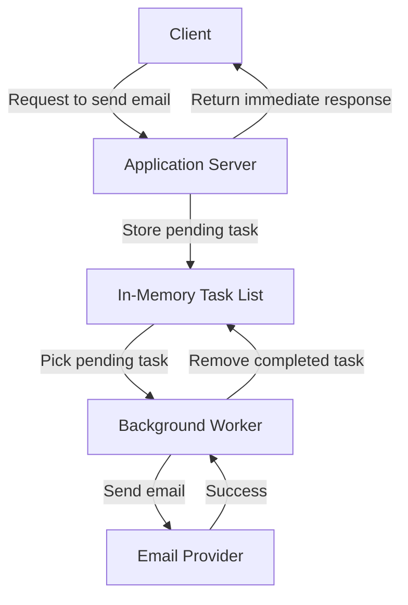
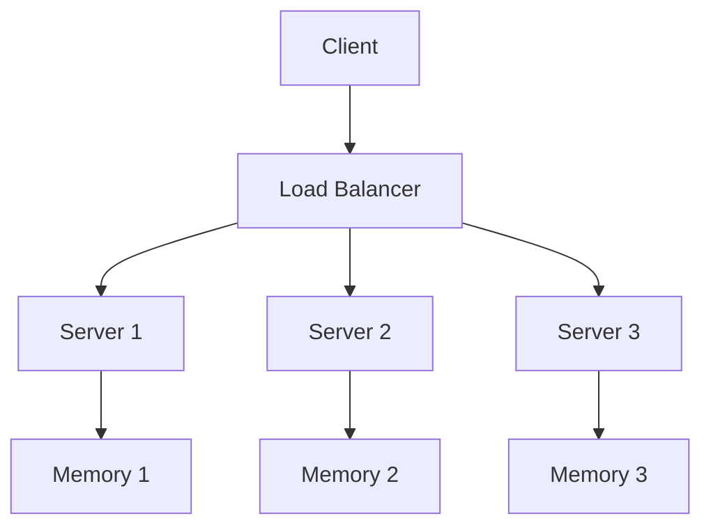

# Solution A: Store Pending Email Tasks in Server Memory

## 1. Approach

We can handle email-sending tasks asynchronously by storing pending tasks in the application's memory.

Instead of making the user wait until an email is sent, the server accepts the request and returns a response immediately. A background process on the same server picks up the task, sends the email, and removes it from memory after successful delivery to the email provider.

**In this approach, we are not using a message queue or a separate database to store pending tasks.**

## 2. Architecture Diagram

## 3. How It Works

1. The client sends a request asking the application to send an email.
2. The application server creates an email task and stores it in its in-memory task list.
3. The server returns a response to the client without waiting for the email to be sent.
4. A background worker picks up the pending task.
5. The worker sends the email through an email provider.
6. After the provider accepts the email successfully, the worker removes the task from memory.

For example, if a user signs up, the application can return a successful signup response while the welcome email is processed in the background.

> Note: A successful response from an email provider generally means it accepted the email for delivery, not that the recipient definitely received it.

## 4. Advantages

- **Fast response:** The client does not need to wait for email processing.
- **Simple implementation:** No separate message broker is required.
- **Background processing:** Email tasks can run independently of the client request.
- **Low initial complexity:** Suitable for understanding asynchronous processing in a single-server application.

## 5. Problems and Limitations

### Problem 1: Multiple application servers

Suppose our application grows and we deploy three servers behind a load balancer.

Each server has its own separate memory.

Imagine the following scenario:

- A request reaches Server 1, which stores an email task in Memory 1.
- Server 2 has no direct access to that task.
- Server 3 also cannot see the task stored in Server 1's memory.
- If Server 1 stops working, its pending in-memory tasks may be lost.

**The core issue:** Each server maintains its own isolated task list. We cannot treat these separate in-memory lists as one shared, reliable task store.

### Problem 2: Server restart or crash

If the application server crashes or restarts, pending tasks stored only in its memory are lost.

### Problem 3: Worker failures

If a worker crashes while processing a task, we need additional logic to determine whether the task should be retried and whether the email may already have been sent.

### Problem 4: Scaling workers

Adding more workers requires coordination so that workers do not accidentally process the same task at the same time.

## 6. Conclusion

This approach demonstrates the basic idea of asynchronous processing, but it is not sufficiently reliable for a distributed application.

It works as a simple starting point when one server is sufficient and occasional task loss is acceptable.

Our next design should address the main limitation: **how can multiple application servers access pending tasks through a shared, reliable mechanism without depending on one server's memory?**

We will use that question to evolve the architecture in the next solution, step by step, before introducing more advanced components.